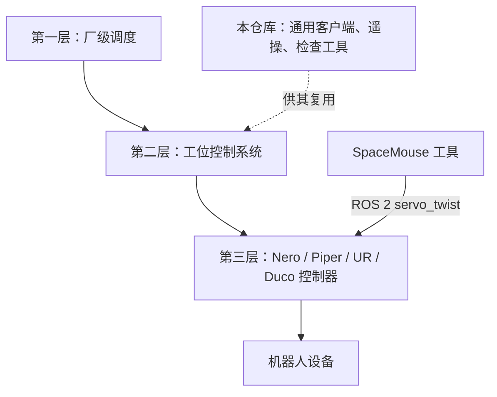

# Robot Application Toolkit

供工业工位控制系统复用的机器人通用工具库。包含统一接口规范、SpaceMouse 遥操、
Python 控制客户端、接口检查和新机器人接入指南。第一版面向 ROS 2 Humble / Ubuntu 22.04 / Python 3.10。

本仓库由第二层工位控制系统使用：不承担厂级调度、工位业务编排或型号相关驱动。
Nero、Piper、未来的 UR / Duco 控制器独立维护，负责第三层的运动执行和安全边界。



## 已实现

- `Joy → TwistStamped` 遥操：100 Hz、死区、按偏转比例控制速度、回中停止、过期输入拒绝和超时处理。
- 使用现有 `/servo_twist` 接口；切换机器人只改命名空间，不导入厂商 SDK。
- 独立 Python HTTP 客户端，支持状态、使能、停止、实时目标、轨迹及等待任务完成。
- `robot_check` 只读检查 API v1 快照；测试覆盖六轴和七轴真实控制器的仿真后端。
- [3dconnexion_ros2](https://github.com/yizhongzhang1989/3dconnexion_ros2) 作为固定版本 submodule，保留原接口和源码。

| 控制器 | 当前项目阶段 | 默认 ROS 命名空间 | 本版接入 |
| --- | --- | --- | --- |
| Nero | 开发中 | `/nero` | 复用 `--ros` 接口 |
| Piper | 测试中 | `/robot` | 复用 `--ros` 接口 |
| UR / Duco | 待接入 | 工位配置指定 | 按统一规范实现，尚未验证 |

## 构建

```bash
git clone --recurse-submodules https://github.com/yizhongzhang1989/robot_application_toolkit.git
cd robot_application_toolkit
source /opt/ros/humble/setup.bash
# 已有仓库也可执行以下命令补齐子模块
git submodule update --init --recursive
rosdep install --from-paths ros2 third_party --ignore-src -r -y
bash scripts/build.sh
source install/setup.bash
```

`rosdep` 需先在机器上初始化。SpaceMouse 需要 `spacenavd` 和 `libspnav-dev`。
SpaceMouse Pro 按钮映射需要 `spacenavd >= 1.1`；系统旧版 0.7.1 的映射不同，
应先按[上游说明](third_party/3dconnexion_ros2/README.md)安装并在实物上检查按钮。
正式安装流程见 [SpaceMouse 系统安装](docs/spacemouse-system-install.md)。
完成 systemd 服务安装后，驱动在后台运行，不需要额外保持前台终端。

仅使用 Python 客户端，不需要 ROS：

```bash
python3 -m venv .venv
.venv/bin/pip install -e ./ros2/robot_application_toolkit
.venv/bin/python examples/inspect_robot.py --url http://127.0.0.1:18089
```

## 第一次运行：仿真 + SpaceMouse

终端一启动 Nero 仿真控制器。其环境安装步骤见 Nero 仓库：

```bash
cd ~/Documents/nero_control
source scripts/env.sh
export ROS_DOMAIN_ID=42
python -m nero_control --backend sim --ros --ros-namespace /nero --port 18089
```

终端二启动工具。双方须使用相同的 `ROS_DOMAIN_ID`、兼容的 RMW 和可通信的网络：

```bash
cd ~/Documents/robot_application_toolkit
source /opt/ros/humble/setup.bash
source install/setup.bash
export ROS_DOMAIN_ID=42
export RMW_IMPLEMENTATION=rmw_cyclonedds_cpp
ros2 launch robot_application_toolkit spacemouse.launch.py robot_namespace:=/nero
```

启动不自动使能。终端三使用相同 ROS 环境，显式使能这个仿真控制器：

```bash
ros2 service call /nero/enable std_srvs/srv/SetBool '{data: true}'
```

默认无需按钮：先让摇帽回中，再推动或扭转；偏转越大速度越高，回中发送短暂零速度，随后停止发布。
如需按住按钮模式，使用 `require_deadman:=true deadman_button:=0`（SpaceMouse Pro 的 `1` 键）。
默认线速度向量上限 0.02 m/s，角速度向量上限 0.1 rad/s。

Piper 仿真改为在其仓库执行 `python -m piper_control --backend sim --ros --port 18088`，
工具使用 `robot_namespace:=/robot`，使能服务为 `/robot/enable`。
两款控制器均先 `source scripts/env.sh`；本工具不启动 CAN 驱动。

## 检查与测试

```bash
# 已构建并 source install/setup.bash
ros2 run robot_application_toolkit robot_check --url http://127.0.0.1:18089 \
  --output .runtime/nero-check.json

# 在已激活的开发环境中安装检查工具
python -m pip install -r requirements-dev.txt
python -m ruff check .
python -m ruff format --check .
# 核心测试；source ROS 后还会运行真实 DDS 传输测试
PYTEST_DISABLE_PLUGIN_AUTOLOAD=1 python3 -m pytest -q

# 可选：使用两款本地控制器的仿真依赖，始终只创建 SimulationBackend
source ~/Documents/nero_control/scripts/env.sh
RAT_TEST_CONTROLLERS=1 PYTEST_DISABLE_PLUGIN_AUTOLOAD=1 python -m pytest -q
```

`robot_check` 验证响应结构和数值，不宣称控制器已具备运动安全或完成真机验收。
控制器独立负责反馈检查、运动限制、实时流看门狗和故障处理；软件 stop 不等同于硬件急停。

文档：[架构边界](docs/architecture.md) · [接口 v1](docs/interface-v1.md) ·
[遥操操作与故障定位](docs/teleoperation.md) · [新机器人接入](docs/new-robot.md) ·
[设计决策](docs/decisions.md) · [验证记录](docs/validation.md) · [贡献流程](CONTRIBUTING.md)。

```text
ros2/robot_application_toolkit/   可独立安装的 ament_python 包
  robot_application_toolkit/     客户端、检查器、遥操核心和 ROS 节点
  launch/ config/                启动文件、遥操参数和控制器清单
third_party/3dconnexion_ros2/     上游 submodule
docs/ examples/ tests/ scripts/  规范、使用示例、验证和构建入口
```

本仓库新增代码使用 Apache-2.0；子模块继续使用各自许可证，见 [NOTICE](NOTICE)。
